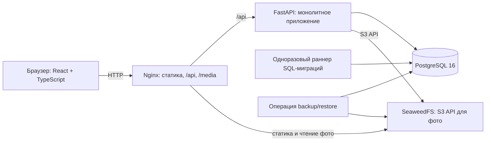
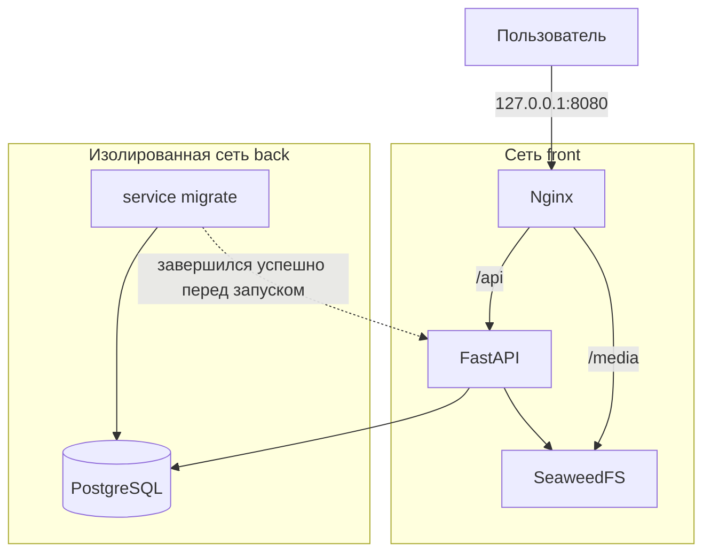

# Этапы IV–VI: архитектура и эксплуатация (вклад Матвея)

Документ подготовлен по практическим работам №15, 26–28, 29–30 и распределению ролей команды. Он сверяет новую основу `fe6459b` (merge PR #13) с локально подготовленными изменениями архитектора. Действия, требующие публикации, запуска стенда или реальных пользователей, отмечены как ожидающие выполнения.

## Сверка с задачами тимлида

| № | Требование | Статус локальной подготовки | Основание / что осталось |
|---|---|---|---|
| 1 | Схема, сравнение архитектур, решение, техдолг и план | **Готово в этом пакете** | Схемы и решение актуализированы под `fe6459b`, включая миграцию V003 и новый регрессионный тестовый слой. |
| 2 | Итоговый работающий стенд и версия релиза | **Частично** | Compose стенд существует; `0.4.0` настраивается через `APP_VERSION` в OpenAPI и `/api/health`. Миграция V003 добавляет `users.auth_version`. Git-тег и развёртывание не созданы, свежий checkout не запускался. Старые результаты README от 25.10.2026 относятся к прежнему коммиту. |
| 3 | Запуск, обновление, откат, миграции, основные действия, логи, backup; HTTPS при внешнем доступе | **Частично** | Инструкции описывают автоматическое применение V003 и проверку `schema_migrations`; backup-скрипт привязан к QA-проекту. Откат обновлённой схемы и данных отдельным стендом не репетировался. HTTPS не нужен для loopback, публичный стенд не настроен. |
| 4 | CI: зависимости → сборка → тесты → артефакт | **Подготовлено локально** | Workflow собирает React, запускает Compose и pytest, затем сравнивает каталог до/после оптимизации на одном runner и публикует отчёты/JUnit как artifact. GitHub ещё не исполнял этот workflow. |
| 5 | Успешный и намеренно проваленный CI, секреты и реакция на сбой; автодеплой если есть среда | **Частично** | Есть временная конфигурация без repository secrets, ручной `simulate_failure` и сохранение логов. Ссылок на green/red runs ещё нет. Публичной среды автодеплоя в проекте не задано. |
| 6 | Проверка доступности, времени ответа и ошибок; логи без секретов | **Подготовлено локально** | `ops/monitor.py` проверяет Nginx и API, latency/ошибки/доступность пишет в JSONL без тел ответов. CI-замер каталога и SVG/Markdown отчёт готовы к запуску. Постоянного внешнего мониторинга и фактических метрик нового коммита пока нет. |
| 7 | Контролируемый сбой, обнаружение и инструкция поиска причины | **Настроено локально; прогон нужен** | CI останавливает backend только в изолированном QA-стеке, проверяет 503/monitor alert, запускает его снова и сохраняет ответ/логи в artifact. Прогон на GitHub ещё не состоялся; шаги диагностики ниже. |

Итого: архитектура, версия API, монитор, сравнительный замер и CI адаптированы к новому backend-коммиту. Пункты 2, 3, 5 и фактическая демонстрация пунктов 6–7 всё ещё требуют публикации и запуска. Не считать прежние smoke-результаты проверкой `fe6459b`.

### Что сохранили из прежней подготовки

| Часть старого пакета | Действие после PR #13 |
|---|---|
| Монолитная схема, сравнение с микросервисами/serverless, решение и техдолг | Оставлены; в описание внесены новые транзакции, auth version и SQL-проекция каталога |
| Инструкция запуска/обновления/отката и сценарий отказа | Оставлены; обновлены сведения о V003, health-версии и статусе проверки |
| CI для сборки/pytest/JUnit и намеренный failure | Сохранены; версия обновлена до 0.4.0 и добавлен парный замер старого/нового каталога |
| HTTP monitor и API health | Скрипт сохранён, API теперь включает версию в схему и ответы 200/503 |
| Ссылки и пояснения для пользователя | README приведён к текущим сервисам compose, добавлены logout и правило повторного платёжного уведомления |

Полный checkout после новых backend-изменений не запускался локально из-за неработающего Docker Desktop. Поэтому прежние локальные результаты не переносились на новый commit как доказательство.

## 1. Архитектура проекта (№15)

### Текущая схема



### Схема тестового развёртывания



В `docker-compose.test.yml` опубликован только Nginx на loopback по умолчанию; БД и backend портов на хост не публикуют. Backend и Nginx работают с read-only root filesystem, без Linux capabilities и с `no-new-privileges`. Миграции выполняются отдельным одноразовым сервисом перед backend. Схема сверена с текущим compose-файлом; публичный HTTPS для локального стенда не настроен и не требуется при доступе только через loopback.

### Сравнение вариантов

| Критерий | Модульный монолит (текущий) | Микросервисы | Serverless |
|---|---|---|---|
| Сложность для учебной команды | Низкая: один backend и один репозиторий | Высокая: сеть, отдельные релизы, наблюдаемость | Средняя/высокая: облачная платформа и ограничения окружения |
| Согласованность заказа и остатков | Одна транзакция PostgreSQL | Нужны распределённые процессы/компенсации | Зависит от платформы и границ функций |
| Масштабирование | Вертикальное или несколько одинаковых backend | Независимо по сервисам | Автоматическое в рамках платформы |
| Эксплуатация и локальный стенд | Docker Compose уже используется | Требуются оркестратор и service discovery | Требуется облачная инфраструктура |
| Вывод для этого проекта | **Оставить** | Не оправданы текущей нагрузкой и размером команды | Не соответствует текущему self-hosted Compose стенду |

**Архитектурное решение:** оставить монолит FastAPI, разделённый по роутерам и сервисной логике, React frontend, PostgreSQL и отдельное S3-совместимое хранилище. Это минимизирует операционные риски для учебной команды и сохраняет транзакционность заказа. Декомпозицию пересматривать при измеренном узком месте или независимых командах/нагрузках, а не заранее.

### Что изменилось в backend-коммите `fe6459b`

| Область | Реализация в новой основе | Архитектурное последствие |
|---|---|---|
| Платёжные уведомления | `payment_service.py` фиксирует порядок блокировок «заказ → платёж» и возвращает уже сохранённый терминальный результат при повторе | Конкурентная операция остаётся в транзакционной границе монолита и PostgreSQL |
| Завершение сеансов | `POST /api/auth/logout` увеличивает `users.auth_version`; миграция `V003__auth_version.sql` добавляет поле без удаления строк | Старые JWT сразу отзываются серверной проверкой версии |
| Каталог | Проекционный SQL-запрос и `EXISTS`; новые regression checks фиксируют фильтры, пагинацию, наличие и видимость | Сначала измеряем запросы/латентность, отдельный поисковый сервис не вводим без результата замера |
| Контракт API | OpenAPI уточняет 401/403/422/204, добавлены проверки реальных ответов против схемы | Спецификация остаётся генерируемой из FastAPI-кода |

CI сравнивает старую и новую реализации каталога с одинаковой синтетической базой и профилем запросов. Это изолирует маршрут, SQL и сериализацию, исключая HTTP-сеть.

### Сеансы и роли после V003

| Правило | Реализация |
|---|---|
| Выдача access token | JWT HS256 с `sub`, `role`, `ver`, `jti`, `iat`, `exp`; время жизни задаётся `JWT_EXPIRE_MINUTES` (по умолчанию 24 часа) |
| Обычный пользователь | При регистрации роль `customer`; защищённые маршруты используют пользователя из проверенного JWT и ограничивают заказы его `user_id` |
| Администратор | Для `/api/admin` `require_admin` читает актуальную роль из БД; смена роли действует сразу, а не при истечении JWT |
| Выход | `POST /api/auth/logout` увеличивает `users.auth_version`; все ранее выданные токены с прежним `ver` отвечают 401 |
| Обновление старой БД | V003 добавляет `auth_version` с default 0; старые активные JWT без `ver` трактуются как версия 0 и продолжают работать до logout/expiry |

Основной регрессионный набор по этим правилам лежит в `tests/pytest/stage3/test_stage4_backend.py`: отзыв всех сеансов, недействительные токены, немедленное снятие admin-роли и проверки 401/403 для операций админки.

### Технический долг и план

| Долг/ограничение | Риск | Следующий шаг | Приоритет |
|---|---|---|---|
| CI отсутствует в `main` | Регрессия обнаружится вручную | Локально добавлен GitHub Actions workflow с JUnit и артефактом benchmark; получить реальные green/red runs | Высокий |
| `/api/health` проверяет БД, но не storage | Состояние файлового сервиса отдельно от состояния API | Версия возвращается в health/OpenAPI; storage отслеживается своим Compose healthcheck, readiness endpoint согласовать при необходимости | Средний |
| Сравнительные замеры каталога ещё не опубликованы | Нет численного основания подтвердить эффект изменения запроса | CI фиксирует одинаковый fixture, хеши ответа, SQL count, median/p95; обсудить результат с Варей | Высокий |
| Логи содержат метод, путь, код и длительность, но нет request ID/метрик-агрегатора | Сложнее связать ошибку пользователя с логами и увидеть тренд | Добавить корреляционный ID и сбор p95/error rate при наличии стенда | Средний |
| Backup требует окна остановки записей | Недоступность на время копирования | Измерить длительность, хранить копию вне узла, проверить восстановление на отдельном compose-проекте | Высокий перед внешним стендом |
| Демонстрация отзывов не подтверждена реальными пользователями | Нельзя обосновать улучшения фиктивными данными | Провести 2–3 наблюдаемых прогона и заполнить карточки ниже | Высокий для №29–30 |

## 2. Итоговый стенд, обновление и откат (№26)

В репозитории уже есть production-like Compose стенд `docker-compose.test.yml`. В локальных изменениях задан кандидат `0.4.0`; это не означает, что релиз собран или развёрнут. Git-тег следует поставить на выбранный коммит после успешного CI и согласования с командой.

### Подготовка и запуск

1. Установить Git, Docker Desktop/Engine с Compose; получить исходный код и перейти в каталог репозитория.
2. Создать `.env` по `.env.example`; заменить все `change-me-*` сильными уникальными значениями. `.env` не коммитить.
3. Проверить diff и текущий коммит. В репозитории готовый backup-скрипт жёстко привязан к QA-проекту; перед выпуском на другом compose-проекте нужен адаптированный и проверенный backup шаг по `ops/README.md`.
4. Собрать и поднять стенд: `docker compose -f docker-compose.test.yml --env-file .env up -d --build`.
5. Проверить `docker compose -f docker-compose.test.yml --env-file .env ps`, логи `migrate`, `/healthz`, `/api/health` и ключевой сценарий покупки.

Для учебного QA используйте отдельный файл `.env.qa` и имя проекта из `tests/README.md`; не запускайте destructive/ops тесты на демонстрационной базе.

### Обновление существующей базы

```sh
docker compose -f docker-compose.test.yml --env-file .env up -d --build
docker compose -f docker-compose.test.yml --env-file .env ps
docker compose -f docker-compose.test.yml --env-file .env logs --no-color migrate backend nginx
```

Для QA-копии команда `sh ops/backup-qa.sh` использует проект `kroy-varvara-nginx-qa` и `.env.qa`. Не использовать её как backup для другого стенда без адаптации compose-проекта и env-файла. Backup нельзя пропускать перед реальным обновлением.

Миграции `db/migrations/V<number>__*.sql` применяет сервис `migrate`; применённые версии и контрольные суммы записываются. Новая миграция `V003__auth_version.sql` добавляет `users.auth_version INTEGER NOT NULL DEFAULT 0 CHECK (auth_version >= 0)` и сохраняет существующие данные/сессии как версию 0. Уже применённый SQL-файл не редактировать. `docker compose down -v` не является откатом: команда удаляет данные тома.

### Откат

1. Остановить публикацию/доступ к стенду и сохранить логи ошибки.
2. Если схема совместима, вернуть предыдущий образ/коммит и поднять сервисы без удаления томов.
3. Если миграция несовместима или данные повреждены, поднять отдельный стенд предыдущего релиза и восстановить проверенную копию БД и медиа по `ops/README.md`.
4. Сверить health, миграции, фото и контрольные бизнес-сценарии перед переключением пользователей.

**Ограничение:** автоматический downgrade SQL-миграций в проекте не реализован. Восстановление из backup проверено отдельным тестовым скриптом согласно `docs/testing-stage3.md`; переключение целого стенда назад ещё требует репетиции на отдельном проекте.

## 3. CI и доказательства прогонов (№27)

Добавлен `.github/workflows/ci.yml`: push, pull request и ручной запуск выполняют сборку React, поднимают изолированный production-like Compose стенд, ждут API health, запускают pytest через Nginx, сравнивают каталог и проводят контролируемый outage drill. Общий pytest run включает новые проверки авторизации, OpenAPI, выхода из всех сессий, скрытия товаров и проекции каталога. На ошибке сохраняются логи сервисов. Пароли одноразовые для runner; secrets репозитория не нужны, production-доступ не используется. Job имеет только `contents: read`.

Шаг каталога берёт `products.py` из коммита `902edb3` — непосредственно до backend PR #13 — запускает `tests/benchmark_catalog.py` внутри того же backend-контейнера, затем запускает текущую реализацию на той же БД и фикстуре. Скрипт сравнения требует совпадения хешей ответов и сохраняет median, p95, число SQL-запросов, Markdown-таблицу и SVG-график. Затем CI останавливает backend в отдельном стеке, проверяет HTTP 503 и ошибку мониторинга, запускает backend снова и проверяет восстановление. Артефакт `ci-evidence` содержит JSON замеров, таблицу/график, JUnit, outage-ответ/заголовки, JSONL мониторинга и логи. Сырые latency зависят от runner; эффект обсуждается с Варей на нескольких одинаковых прогонах, а не объявляется по одному шумному значению.

Для контролируемо проваленного прогона вручную запустить workflow с `simulate_failure=true`. Он намеренно завершится с кодом 1 после успешных проверок, чтобы показать реакцию CI; ошибка помечена в логе и не маскирует тестовый сбой.

**Статус доказательств:** конфигурация подготовлена локально. Ссылок на успешный/намеренно проваленный запуск и benchmark artifact пока нет, так как изменения не опубликованы. После публикации записать обе ссылки и SHA сюда. Если pipeline упал на обычных тестах, исправить причину и повторить green run; не включать искусственный failure для обычной проверки.

## 4. Минимальная наблюдаемость и разбор сбоя (№28)

| Сигнал | Где смотреть | Что считать проблемой | Действие |
|---|---|---|---|
| Доступность прокси | `GET /healthz` через Nginx | Не HTTP 200 | `docker compose ... ps`, затем логи nginx |
| API, PostgreSQL и версия | `GET /api/health` | 503, `status=error` или версия не совпала с кандидатом релиза | Проверить backend/db health и миграции |
| S3 storage | `docker compose ... ps` и healthcheck контейнера storage | Сервис не healthy | Проверить `storage/start.sh` и логи storage; API health намеренно проверяет БД, не S3 |
| Время ответа и статус запросов | Логи backend: `METHOD path -> status (N ms)` | Рост длительности или повторяющиеся 5xx | Сопоставить путь, время и сервисные логи; тело и заголовки запросов не логируются |
| Перезапуски | `docker compose ... ps` и `docker inspect` | Restart count растёт | Снять логи до перезапуска/обновления и проверить последнюю конфигурацию |
| Ротация логов | `docker-compose.test.yml`, `json-file` | Достигнуты 3 файла по 10 MiB | Выгрузить нужный фрагмент, проверить повторяемость ошибки |

Примеры формата по `backend/app/main.py` (иллюстрация, не фактический лог нового прогона):

```text
2026-11-26 12:00:00 INFO kroy: GET /api/health -> 200 (12 ms)
2026-11-26 12:00:05 ERROR kroy: Ошибка БД на GET /api/products: OperationalError
```

Запросный middleware не пишет тело и заголовки запроса. Перед сдачей приложить фактический фрагмент `docker compose ... logs backend nginx` из чистого тестового прогона и повторно проверить его на токены, пароли, телефоны и адреса.

На локальном стенде проверять вручную каждые 1–2 минуты во время демонстрации. Это базовая проверка доступности, а не полноценный внешний мониторинг или SLA. Для сетевого стенда нужен HTTPS, ограничение доступа и внешний мониторинг с учётом политики учебного сервера.

### Контролируемый отказ: backend

Проводить только на отдельном локальном QA-проекте, не на общей демонстрационной базе.

```sh
docker compose -f docker-compose.test.yml --env-file .env.qa -p kroy-varvara-nginx-qa stop backend
curl -i http://127.0.0.1:18080/api/health
docker compose -f docker-compose.test.yml --env-file .env.qa -p kroy-varvara-nginx-qa logs --tail=100 nginx backend
docker compose -f docker-compose.test.yml --env-file .env.qa -p kroy-varvara-nginx-qa start backend
```

**Ожидаемое обнаружение:** healthcheck backend становится unhealthy, Nginx возвращает контролируемый 503 для API, фронт остаётся доступен. После старта backend должен снова стать healthy; повторить `/api/health` и простой сценарий чтения каталога. Записать время обнаружения/восстановления и фактические ответы. Сбой намеренный и обратимый; не отключать БД и не удалять volumes в этой демонстрации.

### Поиск причины

1. Зафиксировать время, URL, ожидаемый/фактический код и последний успешный шаг.
2. Проверить `docker compose ... ps` и healthchecks по цепочке Nginx → backend → БД/storage.
3. Снять `logs --since 10m` до рестарта; сверить последние изменения и статус миграций.
4. Проверить `/healthz` и `/api/health`, затем воспроизвести один запрос без секретов.
5. Исправить или откатить релиз; повторить health и сквозной сценарий; записать причину и коммит.

## 5. Поддержка пользовательской проверки (№29–30)

Результаты пользователей сюда заранее не внесены. Использовать эту карточку отдельно на каждого тестировщика; фиксировать только обезличенные наблюдения.

| Поле | Заполнение |
|---|---|
| Код участника / дата / устройство |  |
| Сценарий | Поиск → корзина → покупка / отмена / другое: ___ |
| Выполнил без помощи? | Да / частично / нет |
| Где остановился или ошибся (точный шаг) |  |
| Цитата/наблюдаемое действие без имени |  |
| Серьёзность | Блокирует / затрудняет / косметика |
| Предложенное исправление и приоритет |  |
| Повторная проверка после изменения | Не проверено / прошло / не прошло |

Минимум для №29: 2–3 прогона основных сценариев, единая инструкция, без наводящих подсказок до момента затруднения. Для №30 выбрать 2–3 повторяющихся или блокирующих замечания, внести их в issue/таблицу дефектов и повторить те же шаги. Отчёт содержит реальные обезличенные итоги и дату, а не заполненные заранее примеры.
