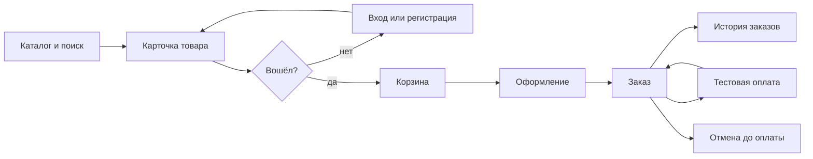

# Проверка интерфейса с Варей

Основа: `main` после обновления 26.11.2026. Рабочая ветка: `feature/varvara-ux-handoff`. Это протокол для совместной проверки; ответы Вари в него пока не внесены.

## Карта переходов



## Замечания и выбранные изменения

| Экран | Было неудобно | Изменение | Что спросить у Вари |
|---|---|---|---|
| Поиск | После ошибки каталога не было явного повтора; запрос терялся из виду в списке | Кнопка повтора, запрос рядом с числом результатов, имя поля для экранного диктора | Понятно ли, какой запрос показан и как повторить загрузку? |
| Корзина | Ссылка на оформление оставалась при количестве больше остатка | Вместо перехода показана причина и нужное действие | Понятно ли, какой товар исправить? |
| Оформление | При отсутствии пунктов самовывоза форма сообщала только «выберите пункт» | Явное предложение курьерской доставки | Можно ли продолжить без подсказки ведущего? |
| Телефон | Каталог растягивался по ширине и обрезал поиск и карточки | Фильтры складываются в колонку, карточки в один столбец до 420 px | Видны ли все действия без горизонтальной прокрутки? |
| История заказов | «Повторить» сохраняла прежний URL, но не отправляла запрос | Кнопка повторяет текущую выборку с тем же фильтром | Удаётся ли продолжить после восстановления сети? |
| Оформление при сбое API | Ошибка пунктов выдачи скрывала форму доставки | Пункты можно загрузить повторно, курьерская доставка доступна | Понятно ли, как продолжить оформление? |
| Фото товара | При ошибке загрузки отображался значок сломанной картинки | Подставляется существующий силуэт товара | Можно ли узнать тип вещи по силуэту? |

## Таблица UI → API

Все пути ниже имеют префикс `/api`.

| Действие | Endpoint | Ожидаемый результат в UI |
|---|---|---|
| Открыть каталог, искать, фильтровать | `GET /products`, `GET /filters` | Список и число результатов, либо пустое состояние/ошибка с повтором |
| Открыть товар | `GET /products/{id}` | Варианты, остаток, цена |
| Зарегистрироваться, войти, восстановить сеанс, выйти | `POST /auth/register`, `POST /auth/login`, `GET /auth/me`, `POST /auth/logout` | Вход открывает корзину и историю, выход завершает сеанс |
| Добавить в корзину | `POST /cart` | Сообщение о добавлении и количестве |
| Открыть корзину | `GET /cart` | Позиции или ссылка в каталог при пустоте |
| Изменить количество | `PATCH /cart/items/{id}` | Обновлённые количество и сумма |
| Удалить позицию | `DELETE /cart/items/{id}` | Позиция исчезает, сумма обновляется |
| Выбрать получение | `GET /pickup-points` | Пункты выдачи или предложение доставки |
| Подтвердить заказ | `POST /orders` | Переход к заказу; повтор запроса с тем же ключом не создаёт дубль |
| Открыть заказ и историю | `GET /orders/{id}`, `GET /orders` | Статус, товары, история либо пустое состояние |
| Тестовая оплата | `POST /orders/{id}/payments`, `POST /test-provider/payments/{id}`, `GET /payments/{id}` | Результат и обновлённый статус заказа |
| Отменить неоплаченный заказ | `POST /orders/{id}/cancel` | Статус «Отменён», действие оплаты исчезает |
| Просмотреть, создать, изменить товар | `GET /admin/products`, `POST /admin/products`, `GET /admin/products/{id}`, `PATCH /admin/products/{id}` | Список и детали показывают актуальные данные |
| Добавить или изменить вариант | `POST /admin/products/{id}/variants`, `PATCH /admin/variants/{id}` | Вариант появляется на странице товара или меняет параметры |
| Изменить остаток, открыть журнал | `POST /admin/variants/{id}/stock-movements`, `GET /admin/variants/{id}/stock-movements` | Остаток меняется; журнал содержит операцию |
| Загрузить, изменить, удалить фото | `POST /admin/products/{id}/images`, `PATCH /admin/images/{id}`, `DELETE /admin/images/{id}`, `GET /media/{key}` на корне сайта | Фото появляется, меняет порядок или исчезает |
| Админка заказов | `GET /admin/orders`, `GET /admin/orders/{id}`, `POST /admin/orders/{id}/status` | Фильтр и новый статус видны после действия |

## Сценарии для совместной проверки (2–3 участника/прогона)

1. **Покупка:** найти товар по названию → выбрать размер и цвет → добавить → изменить количество → самовывоз → тестовая успешная оплата → найти заказ в истории. Проверить итоговую сумму и статус.
2. **Отмена:** добавить товар → выбрать доставку → оформить → отменить до оплаты → проверить статус и возврат остатка в каталоге.
3. **Ошибки и права:** искать несуществующий товар; открыть пустую корзину; временно остановить API и проверить сообщение/повтор; открыть `/admin/products` покупателем; изменить остаток администратором и обновить карточку.

Для каждого прогона Варя фиксирует: дата, ширина экрана (360/768/desktop), участник, задача, прошёл ли без подсказок, время, где остановился, дословный отзыв, выбранное исправление и результат повторной проверки. Не использовать реальные платёжные данные.

| Прогон | Участник и дата | Результат | Отзыв | Исправление | Повторная проверка |
|---|---|---|---|---|---|
| 1 | Заполняет Варя | Не проводился | — | — | — |
| 2 | Заполняет Варя | Не проводился | — | — | — |
| 3 (по желанию) | Заполняет Варя | Не проводился | — | — | — |

## Результаты браузерной проверки

Playwright запущен в Edge на локальной учебной базе с миграцией V003. Для обычных действий браузер использовал реальный API. Для воспроизведения сетевых ошибок, пустого списка пунктов, недоступного фото и нехватки остатка тест подменял отдельные ответы браузера.

| Сценарий | Наблюдаемый результат |
|---|---|
| Загрузка и пустые данные | Задержка ответа каталога показывает «Загрузка…». Поиск без совпадений, пустая корзина и пустая история выводят соответствующие состояния. |
| Ошибки и повтор | Каталог и история восстанавливаются после повторного запроса. После ошибки изменения корзины старая сумма сохраняется, после успешного повтора обновляется. Неудачная загрузка пункта выдачи позволяет повторить запрос и продолжить курьером. |
| Доступ | Гость видит приглашение войти, покупатель видит «Недостаточно прав» и не видит ссылку админки. Реальный API вернул 401 гостю и 403 покупателю. |
| Покупка №11 | Поиск → выбор варианта → корзина → увеличение количества и пересчёт суммы → проверка номера → самовывоз → тестовая оплата → статус «Оплачен» и запись в истории. После покупки корзина пуста. |
| Отмена №12 | Курьерский заказ отменён до оплаты. Кнопка оплаты исчезла, статус в истории обновился. Остаток был 8 перед заказом, 7 после создания и 8 после отмены. |
| Администрирование | Администратор нашёл оплаченный заказ по email и статусу. После сохранения карточка показала «Передан в доставку». |
| Мобильная вёрстка | На 360 px проверены регистрация, каталог, карточка, корзина, самовывоз, заказ, платёж и история. На 390 px проверены курьерское оформление, заказ и админка. На 768 px проверена история с фильтром. Измеренная ширина документа не превышает ширину окна. |
| Сборка и JavaScript | TypeScript и Vite завершились успешно. В браузерном прогоне покупателя нет необработанных ошибок JavaScript. |

### Повторный запуск

Запустить проект на локальной учебной базе с тестовой оплатой. Проверка добавляет собственного покупателя и два учебных заказа. Товар «Футболка базовая» (ID 1) должен иметь вариант с остатком от трёх единиц.

```powershell
npm install --prefix .local/qa --no-save playwright
$env:PLAYWRIGHT_MODULE = "$PWD/.local/qa/node_modules/playwright"
$env:QA_CHROMIUM = 'C:/Program Files (x86)/Microsoft/Edge/Application/msedge.exe'
node tests/ux_checkout.cjs
```

`QA_URL` по умолчанию указывает на `http://127.0.0.1:5173`. Для проверки администратора задать `QA_ADMIN_EMAIL` и `QA_ADMIN_PASSWORD` от учебной учётной записи. Для парных снимков задать `QA_BASELINE_URL` с адресом локальной сборки `fe6459b` и `QA_SCREENSHOTS` с каталогом вывода. Обе сборки используют одну учебную базу.

## Отчёт со скриншотами

В отдельном PDF «Крой — отчёт по проверке интерфейса» собраны пары «до/после» для каталога, корзины и оформления, а также два мобильных снимка. Снимки каждой пары сделаны в Edge на одной ширине и с одинаковыми ответами API. Кадры «до» соответствуют `fe6459b`, кадры «после» — `807218b`.
