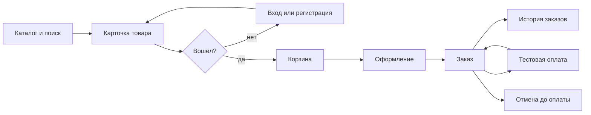

# Проверка интерфейса с Варей

Основа: `main` после обновления 26.11.2026. Рабочая ветка: `feature/varvara-ux-handoff`. Это протокол для совместной проверки; ответы Вари в него пока не внесены.

## Карта переходов

## Замечания и выбранные изменения

| Экран | Было неудобно | Изменение | Что спросить у Вари |
|---|---|---|---|
| Поиск | После ошибки каталога не было явного повтора; запрос терялся из виду в списке | Кнопка повтора, запрос рядом с числом результатов, имя поля для экранного диктора | Понятно ли, какой запрос показан и как повторить загрузку? |
| Корзина | Ссылка на оформление оставалась при количестве больше остатка | Вместо перехода показана причина и нужное действие | Понятно ли, какой товар исправить? |
| Оформление | При отсутствии пунктов самовывоза форма сообщала только «выберите пункт» | Явное предложение курьерской доставки | Можно ли продолжить без подсказки ведущего? |
| Телефон | Каталог растягивался по ширине и обрезал поиск и карточки | Фильтры складываются в колонку, карточки в один столбец до 420 px | Видны ли все действия без горизонтальной прокрутки? |

## Таблица UI → API

Все пути ниже имеют префикс `/api`.

| Действие | Endpoint | Ожидаемый результат в UI |
|---|---|---|
| Открыть каталог, искать, фильтровать | `GET /products`, `GET /filters` | Список и число результатов, либо пустое состояние/ошибка с повтором |
| Открыть товар | `GET /products/{id}` | Варианты, остаток, цена |
| Добавить в корзину | `POST /cart` | Сообщение о добавлении и количестве |
| Открыть корзину | `GET /cart` | Позиции или ссылка в каталог при пустоте |
| Изменить количество | `PATCH /cart/items/{id}` | Обновлённые количество и сумма |
| Удалить позицию | `DELETE /cart/items/{id}` | Позиция исчезает, сумма обновляется |
| Выбрать получение | `GET /pickup-points` | Пункты выдачи или предложение доставки |
| Подтвердить заказ | `POST /orders` | Переход к заказу; повтор запроса с тем же ключом не создаёт дубль |
| Открыть заказ и историю | `GET /orders/{id}`, `GET /orders` | Статус, товары, история либо пустое состояние |
| Тестовая оплата | `POST /orders/{id}/payments`, `POST /test-provider/payments/{id}`, `GET /payments/{id}` | Результат и обновлённый статус заказа |
| Отменить неоплаченный заказ | `POST /orders/{id}/cancel` | Статус «Отменён», действие оплаты исчезает |
| Админка товаров | `GET/POST /admin/products`, `PATCH /admin/products/{id}`, `/admin/variants/{id}`, `/admin/stock/*`, `/admin/images/{id}` | Список и детали обновляются; покупатель получает отказ |
| Админка заказов | `GET /admin/orders`, `GET /admin/orders/{id}`, `POST /admin/orders/{id}/status` | Фильтр и новый статус видны после действия |

## Сценарии для совместной проверки (2–3 участника/прогона)

1. **Покупка:** найти товар по названию → выбрать размер и цвет → добавить → изменить количество → самовывоз → тестовая успешная оплата → найти заказ в истории. Проверить итоговую сумму и статус.
2. **Отмена:** добавить товар → выбрать доставку → оформить → отменить до оплаты → проверить статус и возврат остатка в каталоге.
3. **Ошибки и права:** искать несуществующий товар; открыть пустую корзину; временно остановить API и проверить сообщение/повтор; открыть `/admin/products` покупателем; изменить остаток администратором и обновить карточку.

Для каждого прогона Варя фиксирует: дата, ширина экрана (360/768/desktop), участник, задача, прошёл ли без подсказок, время, где остановился, дословный отзыв, выбранное исправление и результат повторной проверки. Не использовать реальные платёжные данные.

| Прогон | Участник и дата | Результат | Отзыв | Исправление | Повторная проверка |
|---|---|---|---|---|---|
| 1 | Заполняет Варя | Не проводился | — | — | — |
| 2 | Заполняет Варя | Не проводился | — | — | — |
| 3 (по желанию) | Заполняет Варя | Не проводился | — | — | — |

## Проверка состояний

Загрузка: при медленном API виден индикатор, повторное нажатие на оформление блокируется. Пустые данные: каталог, корзина, история и админские списки дают понятный выход. Ошибки: сеть и валидация показываются рядом с действием; повтор каталога сохраняет запрос. Права: гостя ведёт на вход, покупатель не видит ссылку админки, API дополнительно отвечает 403. Обновление: корзина, заказ и админские списки перечитываются после действий.

## Автоматические результаты 26.11.2026

- Сквозной сценарий покупки: изменение и удаление позиции, самовывоз, успешная тестовая оплата, история, передача и доставка заказа. Заказ №6, итоговый статус `delivered`.
- Сквозной сценарий отмены: курьерский заказ №7 → `cancelled`; остаток выбранного варианта до и после — 6.
- TypeScript и Vite build прошли. Скриншот на узком окне выявил горизонтальную обрезку каталога; CSS скорректирован. Проверка на реальном мобильном устройстве остаётся задачей Вари.
- Контролируемая ошибка API 500 использована для пары снимков каталога: на новом экране появилась кнопка «Повторить загрузку». Эта ошибка возникла до применения локальной миграции V003; затем миграция применена и оба сквозных сценария прошли.

## Скриншоты и сдача

Готовая пара настоящих снимков на одинаковом запросе и ширине: [каталог до](varvara-ux-screenshots/catalog-before.png) (`fe6459b`) и [после](varvara-ux-screenshots/catalog-after.png) (текущая ветка). [Узкое окно после](varvara-ux-screenshots/catalog-mobile-after.png) — отдельный артефакт, не доказательство проверки на физическом телефоне. Для корзины с недостаточным остатком и оформления без пунктов выдачи Варя должна снять пары на подготовленных тестовых данных. После отзывов дополнить таблицу прогонов и внести выбранные исправления отдельным коммитом; не подменять реальные результаты предположениями.
